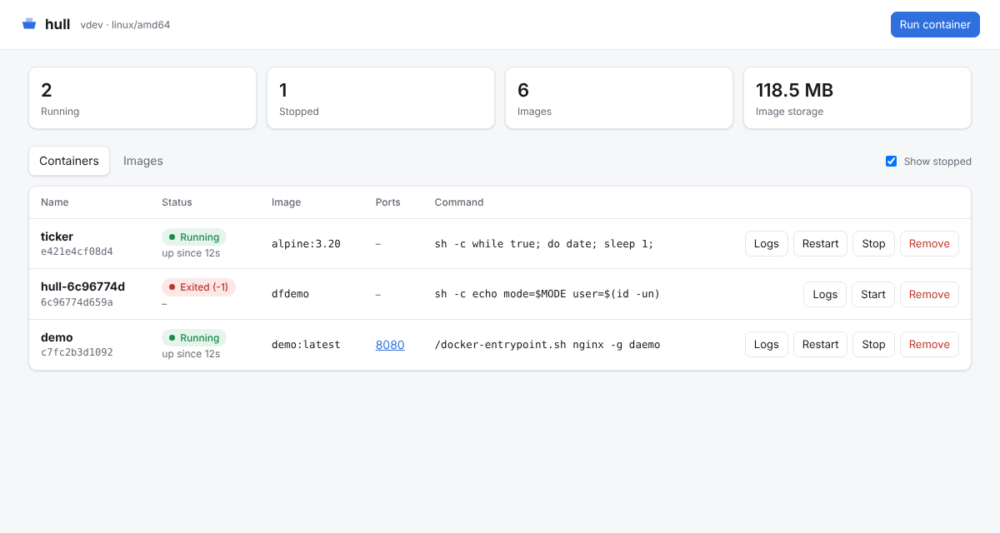

# hull

A lightweight, daemonless container tool. hull builds **standard OCI images** from a small per-project `hull.yaml` (or a Dockerfile). It runs them with Linux namespaces, cgroups and overlayfs, and pushes them to any registry, so you can deploy with Terraform to ECS, Cloud Run, Kubernetes or anywhere else that runs Docker images.

It ships as a single Go binary with no daemon. A small web dashboard (`hull ui`) lets you manage your containers. MIT licensed.

```
hull init        # writes hull.yaml for your project (React, static, Node or Dockerfile)
hull build       # builds an OCI image into the local store
hull run -d      # runs it in the background
hull ui          # dashboard at http://127.0.0.1:7070
hull push        # sends it to your registry, ready for Terraform
```

## Why hull

- **Images work everywhere.** Output is plain OCI. Docker, containerd, Kubernetes, ECS and Cloud Run run hull images unchanged, and `hull save` writes a tarball that `docker load` accepts.
- **One file per project.** `hull.yaml` holds the build stages, the run settings and the registry target. You can point it at an existing Dockerfile instead.
- **No daemon.** Each command does its own work, like Podman. Containers run under a tiny supervisor process, so `hull` itself can exit.
- **Fast rebuilds.** COPY layers are reproducible (fixed timestamps and order), and RUN layers are cached by their inputs.
- **Builds on a Mac.** Builds that only copy files (for example a prebuilt React `dist/` folder into nginx) need neither Linux nor root. You can even target `linux/amd64` from an Apple Silicon Mac.

## Install

```sh
git clone https://github.com/shubhamstrength/hull && cd hull
make build            # needs Go 1.24+
sudo make install     # copies ./hull to /usr/local/bin
```

| | Linux | macOS |
| --- | --- | --- |
| `build` (COPY, ENV, CMD, ...) | ✅ | ✅ |
| `build` with RUN steps | ✅ as root | Run hull in a Linux VM (e.g. `lima`, `multipass`) |
| `run`, `ps`, `stop`, `logs`, `ui` | ✅ as root | View-only in `ui`; run hull in a Linux VM |
| `push`, `pull`, `save`, `images` | ✅ | ✅ |

## Containerising a React app

```sh
cd my-react-app
hull init                 # detects React (Vite or CRA) and writes hull.yaml + nginx.conf + .hullignore
sudo hull build           # stage 1: npm ci && npm run build in node:20-alpine
                          # stage 2: copies dist/ into nginx:1.27-alpine, served on :8080
sudo hull run -d          # http://localhost:8080 (client-side routes fall back to index.html)
```

On a Mac without a Linux VM, build the app yourself and use the copy-only template:

```sh
npm run build
hull init --template static --force
hull build && hull push
```

The generated `hull.yaml` for a Vite app looks like this:

```yaml
name: my-react-app
image: my-react-app            # set to e.g. ghcr.io/you/my-react-app before pushing
tags: [latest]
platform: linux/amd64

stages:
  - name: build
    from: node:20-alpine
    steps:
      - workdir: /app
      - copy: { src: [package.json, package-lock.json], dest: ./ }
      - run: npm ci
      - copy: { src: ., dest: . }
      - run: npm run build
  - from: nginx:1.27-alpine
    steps:
      - copy: { src: nginx.conf, dest: /etc/nginx/conf.d/default.conf }
      - copy: { from: build, src: /app/dist, dest: /usr/share/nginx/html }
      - expose: "8080"
      - cmd: ["nginx", "-g", "daemon off;"]

run:
  ports: ["8080"]
  memory: 256m
```

## hull.yaml reference

| Key | Meaning |
| --- | --- |
| `name` | Project name; the local image name when `image` is not set. |
| `image` | Repository to push to, e.g. `ghcr.io/me/app` or an ECR URL. |
| `tags` | Tags to apply (default `[latest]`). |
| `platform` | `os/arch`, default `linux/<this machine>`. RUN steps need it to match the machine. |
| `context` | Directory COPY reads from (default: the folder holding hull.yaml). |
| `dockerfile` | Use this Dockerfile instead of `stages`. |
| `args` | Values for the Dockerfile's `ARG`s. |
| `stages[]` | `name`, `from` (an image, an earlier stage, or `scratch`) and `steps`. The last stage is the image. |
| `run` | Defaults for `hull run`: `ports`, `env`, `volumes`, `cmd`, `memory`, `cpus`, `pids`, `network`. |

Each step sets exactly one of these: `run`, `copy: {src, dest, from}`, `env`, `workdir`, `expose`, `cmd`, `entrypoint`, `user`, `label`. `cmd` and `entrypoint` take a list, or a string that runs with `/bin/sh -c`.

`.hullignore` (or `.dockerignore`) keeps files out of the build context, using the same pattern syntax.

### Dockerfile support

hull supports the common Dockerfile instructions: `FROM ... AS`, `ARG`, `ENV`, `RUN`, `COPY`/`ADD` (local files, `--from=<stage>`), `WORKDIR`, `EXPOSE`, `CMD`, `ENTRYPOINT`, `USER` and `LABEL`. Other instructions, such as `HEALTHCHECK` or `VOLUME`, print a warning and are skipped.

## Commands

| Command | What it does |
| --- | --- |
| `hull init [--template auto\|react\|static\|node\|dockerfile]` | Create `hull.yaml` for this project. |
| `hull build [-t tag] [--no-cache] [--pull] [--platform p]` | Build and store the image. |
| `hull run [-d] [--name n] [-p 8080] [-e K=V] [-v ./data:/data[:ro]] [-m 256m] [--cpus 0.5] [--pids 100] [--network host\|none] [--rm] [image] [cmd...]` | Run a container. With no image it runs the project's image with its `run:` settings. |
| `hull ps [-a]` / `start` / `stop [-t s]` / `rm [-f]` / `logs [-f] [--tail n]` | Manage containers. |
| `hull images` / `pull` / `tag` / `rmi` / `inspect` | Manage local images. |
| `hull push [--digest-file f] [image]` | Push the project's tags, or a given image. Prints `repo@sha256:...`. |
| `hull save -o app.tar <image>` | Write a tarball for `docker load`. |
| `hull login -u user --password-stdin <registry>` | Check and save registry credentials. |
| `hull ui [--addr 127.0.0.1:7070]` | Web dashboard. |

Credentials are looked up in this order: `HULL_REGISTRY_USER`/`HULL_REGISTRY_PASSWORD`, then `hull login`, then Docker's `~/.docker/config.json` (including credential helpers such as `docker-credential-ecr-login`).

## Dashboard



`sudo hull ui` serves a dashboard on `http://127.0.0.1:7070`. It lists containers with their status, ports and command, and lets you start, stop, restart and remove them. It also shows live logs, lists local images (run or remove from there), and has a **Run container** form for the image, name, ports, memory, CPU, environment and command. It only answers on localhost, and every request that changes something must carry an `X-Hull` header, so other websites can't drive it.

## Deploying with Terraform

`deploy/terraform` contains two reusable modules and two examples:

- `modules/aws-ecs-fargate`: an ECS cluster, a Fargate service, an ALB, logs and an IAM role.
- `modules/gcp-cloud-run`: a Cloud Run v2 service, public by default.

AWS flow, using `examples/aws-ecs`:

```sh
cd deploy/terraform/examples/aws-ecs
terraform init
terraform apply -target=aws_ecr_repository.app              # creates the registry
# put the repository_url output in hull.yaml as image:, then from your project:
aws ecr get-login-password | hull login -u AWS --password-stdin <account>.dkr.ecr.<region>.amazonaws.com
hull build && hull push --digest-file image.txt
terraform apply -var "image=$(cat /path/to/project/image.txt)"   # prints the public URL
```

Pin images by digest, as `hull push` prints them, so Terraform sees a change on every new build and rolls the service.

## How it works

For each RUN step, `hull build` stacks the image's unpacked layers as overlayfs lower directories and runs the command in new namespaces. The overlay's upper directory, which holds exactly what the command changed, becomes the new layer: overlay whiteouts are converted to OCI `.wh.` files. COPY steps write a tarball directly, without running anything.

`hull run` re-executes itself with `CLONE_NEWNS|NEWPID|NEWUTS|NEWIPC` (plus `NEWNET` for `--network none`). It puts the process in a cgroup (v2, with a v1 fallback) for memory, CPU and process limits, then mounts the overlay root with a fresh `/proc`, a minimal `/dev` and a read-only `/sys`. It calls `pivot_root`, drops to Docker's default capability set, switches user and execs the command. Detached containers are watched by a small shim that records the exit code and writes logs to `container.log`.

Everything lives under `~/.local/share/hull` (or `$HULL_HOME`). `store/` is a standard OCI image layout, `layers/` holds unpacked layers shared by all containers, `containers/` holds container state, logs and writable layers, and `cache/` holds RUN layers.

See [docs/RESEARCH.md](docs/RESEARCH.md) for the study of Docker, Podman, runc and buildah that shaped this design.

## Limits (v1)

- Containers share the host network, so `-p 8080` publishes the port the app listens on, and `-p 9000:8080` can't remap it. Use `--network none` for isolation.
- There's no user-namespace (rootless) mode yet, so running needs root.
- Builds are single-platform. Use `--platform` to pick the target; RUN steps must match the host CPU.
- `ADD` with URLs and the `HEALTHCHECK`, `VOLUME` and `SHELL` instructions are not supported.

## Development

```sh
make test          # unit tests (no root needed)
sudo make e2e      # builds an app, runs it, checks HTTP, the dashboard API and save
```

## License

MIT, see [LICENSE](LICENSE).
